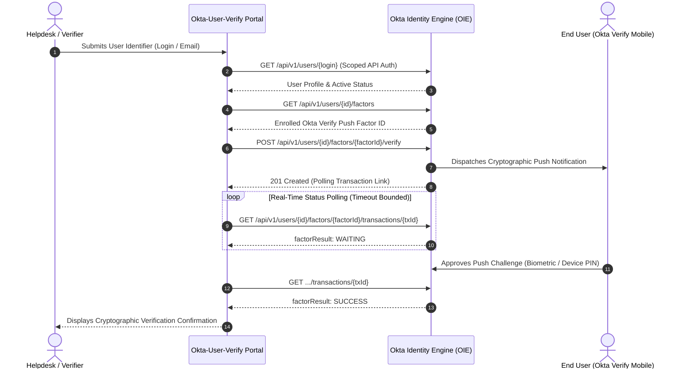

# Okta-User-Verify — Out-of-Band MFA Verification Portal

Custom step-up identity verification portal leveraging **Okta Identity Engine (OIE)** Authenticators and Factors REST APIs to trigger and poll real-time **Okta Verify** push notifications—eliminating static Knowledge-Based Authentication (KBA) and voice-based social engineering across IT helpdesk and high-assurance workflows.

---

## Architecture & Verification Flow

Helpdesk teams frequently fall back to weak identity proofing (employee IDs, manager names, last four of SSN) when locked-out users call in for password resets or MFA re-enrollment. **Okta-User-Verify** replaces static KBA with cryptographic, out-of-band push verification bound to the user's enrolled Okta Verify device:



---

## Security Controls & Design Principles

* **Elimination of Static KBA:** Replaces easily phished or social-engineered helpdesk verification questions with possession- and biometric-backed out-of-band push approval.
* **Environment-Isolated Secrets:** All Okta tenant URLs and API credentials are loaded strictly via environment variables (`.env` excluded via `.gitignore`)—zero hardcoded secrets in source control.
* **Least-Privilege API Scoping:** Restricts backend API access strictly to user lookup and factor challenge initiation/polling rather than broad Super Admin privileges.
* **Bounded Polling & Timeout Handling:** Enforces explicit polling intervals and challenge expiration handling (`WAITING`, `SUCCESS`, `REJECTED`, `TIMEOUT`) to prevent hung worker threads or replay ambiguity.

---

## Quickstart

### 1. Clone & Configure Environment
```bash
git clone [https://github.com/apensabene/Okta-User-Verify.git](https://github.com/apensabene/Okta-User-Verify.git)
cd Okta-User-Verify

python -m venv .venv
source .venv/bin/activate  # On Windows: .\.venv\Scripts\Activate.ps1
pip install -r requirements.txt
```

### 2. Set Required Environment Variables
```bash
export OKTA_ORG_URL="[https://dev-000000.oktapreview.com](https://dev-000000.oktapreview.com)"
export OKTA_API_TOKEN="your-scoped-okta-token"
```

### 3. Run the Verification Portal
```bash
python app.py
```

---

## Disclaimer
This repository is a sanitized reference implementation built for architectural demonstration and sandbox testing. Always deploy behind authenticated SSO/RBAC controls (e.g., Okta OIDC login restricted to Helpdesk/IAM groups) and TLS in production.

---

## Author

**Anthony Pensabene, CISSP** — Identity Security Engineer & Okta Subject Matter Expert  
* **GitHub:** [github.com/apensabene](https://github.com/apensabene)
* **LinkedIn:** [linkedin.com/in/apensabene](https://linkedin.com/in/apensabene)